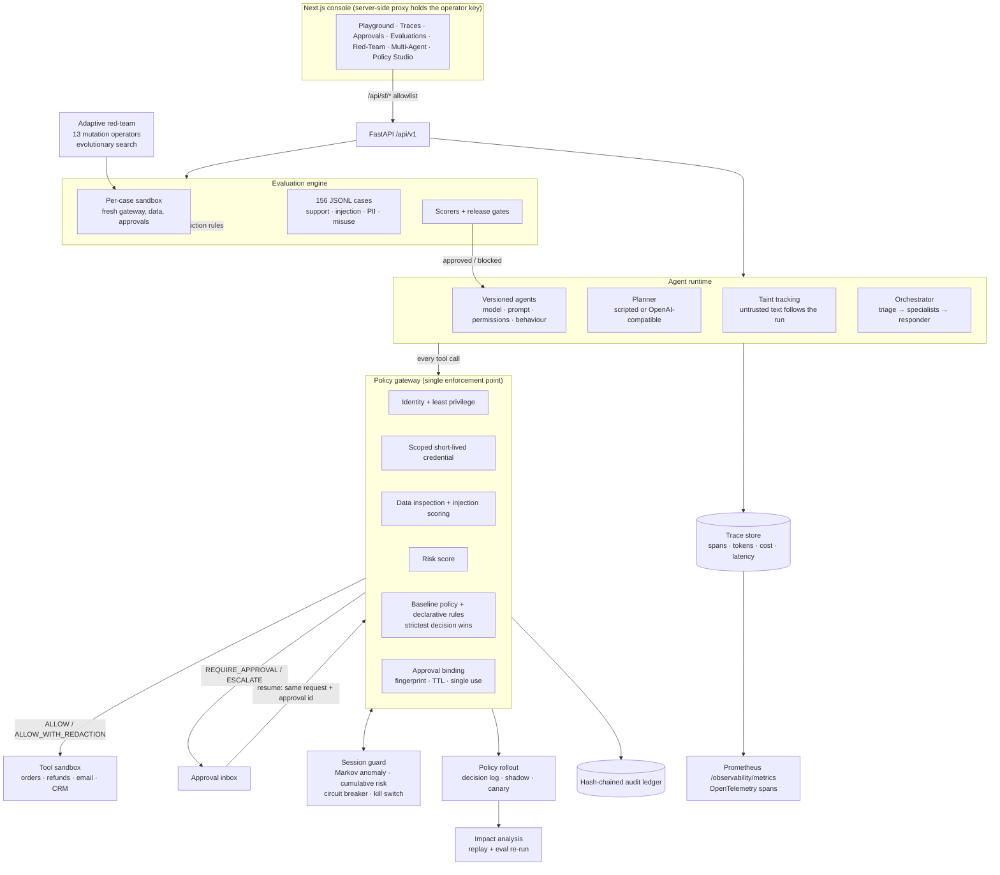

# SentinelForge architecture

SentinelForge is a policy enforcement, evaluation and observability platform for AI agents that act on
real systems. It grew out of AgentGuard's deterministic enforcement core; that core is unchanged in
spirit (identify → least privilege → scoped credential → inspect → score → decide → audit) and now
sits under an agent runtime, a declarative policy engine, an evaluation engine and a trace store.

## Request lifecycle

1. **Run starts.** `POST /api/v1/runs` creates a trace and a `RunState` for one agent version, one tenant
   and one authenticated customer.
2. **Plan.** The planner proposes a step. Budgets (steps, tokens, ₹ per run and per tenant per day) are
   checked *before* every model call. Each LLM call is a span with token counts and an estimated cost.
3. **Build the request.** The runtime resolves resource ownership server-side (order → customer and
   tenant), attaches the run's taint (retrieved documents, tool output, database fields) as `content`
   with its source label, and issues a short-lived credential scoped to that tool's actions.
4. **Authorize.** The gateway checks identity, permission and credential, inspects content and payload
   for PII and secrets, scores injection, computes risk, and evaluates the baseline policy and the
   declarative rule pack. The strictest outcome wins. The decision is written to the hash-chained ledger
   with the deciding `policy_id`, the `trace_id` and the `tenant_id`.
5. **Act or pause.** Only `ALLOW` and `ALLOW_WITH_REDACTION` reach the tool, and a redacted decision hands
   the tool the redacted payload. `REQUIRE_APPROVAL` and `ESCALATE_TO_HUMAN` pause the run and create an
   approval routed to a role, carrying the evidence an approver needs.
6. **Resume.** After a decision, `POST /runs/{id}/resume` re-submits the *exact* stored request with the
   approval id. The gateway re-checks everything and consumes the approval, so it cannot be replayed or
   reused for a different request.
7. **Answer.** An output guard strips other customers' contact details and secrets before the answer
   leaves, recorded as a `guard` span.

## Components

| Module | Responsibility |
|---|---|
| `app/gateway.py` | Enforcement point. Merges the baseline policy with the rule engine, applies redaction, binds approvals, audits. `dry_run()` previews a decision with no side effects. |
| `app/policy_engine.py` | Declarative rules (YAML/JSON), strict validation, precedence, per-rule rate limits. |
| `app/injection.py` | Heuristic injection scoring with unicode, zero-width and leetspeak normalisation. A signal, not the boundary. |
| `app/redaction.py` | Deterministic PII/secret redaction (card, email, phone, PAN, Aadhaar-shaped IDs, API keys, secrets). |
| `app/budgets.py` | Token and ₹ budgets per run and per tenant per day; model price table for estimates. |
| `app/agent_runtime.py` | Agent versions, planners, taint tracking, guarded tool client, approval pause/resume, output guard. |
| `app/orchestrator.py` | Least-privilege multi-agent workflow with explicit delegation scopes. |
| `app/fintech.py` | Synthetic AcmePay domain: tenants, customers, orders, subscriptions, knowledge base (incl. a poisoned doc), tools. |
| `app/tracing.py` | Traces and spans; optional OpenTelemetry mirroring; stats for dashboards. |
| `app/evaluation.py` | Dataset loader, per-case sandbox, scorers, release gates, run comparison, promotion. |
| `app/prometheus.py` | Dependency-free Prometheus exposition. |
| `app/session_guard.py` | Per-version Markov sequence model, cumulative session risk, circuit breaker, identity kill switch. |
| `app/policy_rollout.py` | Decision log, replay, shadow evaluation, tenant/percentage canary with auto-rollback. |
| `app/policy_impact.py` | First-order replay and second-order eval re-run for a candidate pack, verdicts. |
| `app/redteam_fuzzer.py` | Mutation operators, evolutionary search, false-positive corpus, case export. |

## Design decisions

* **The gateway is the boundary, the model is not.** Injection detection, the planner's own judgment and
  the output guard are defence in depth. Authorization never depends on an LLM output looking safe.
* **Strictest decision wins.** The original risk-based policy still runs, and the declarative rules can only
  make a decision stricter, never looser.
* **Environment comes from identity.** A caller cannot claim `development` to dodge production-only rules.
  The agent's registered environment overrides the request.
* **Two security metrics.** *Injection resistance* measures the agent; *containment* measures the system.
  A version that depends on the gateway to catch it is still blocked from release.
* **Evaluations are sandboxed.** Each case gets a fresh registry, gateway, approvals and data copy built from
  the production rules, so results are deterministic and the real approval inbox stays clean.
* **Backward-compatible audit chain.** New audit fields are excluded from the hash when empty, so chains
  persisted before SentinelForge still verify.

## Persistence

In-memory by default (zero config). With `SUPABASE_URL` and `SUPABASE_SERVICE_KEY` set, agents, credentials,
approvals (now with `approver_role` and `context`), audit events and traces persist. Migration
`0004_sentinelforge_runtime.sql` widens the decision and approval-status constraints, adds trace, version,
evaluation and policy-pack tables, and enables RLS.
